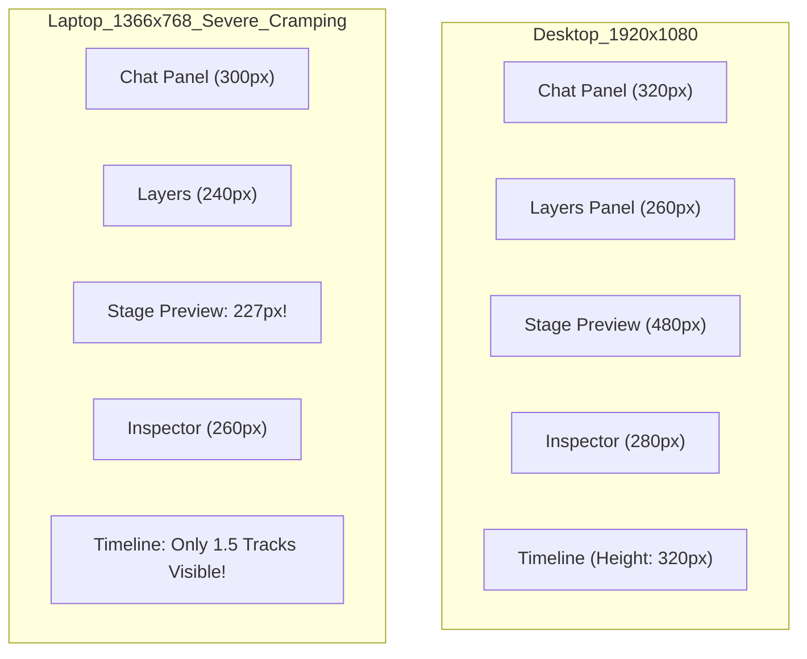

# VIRALMINT — MOTION TIMELINE & REFINE WORKSPACE UX AUDIT
**Document Version:** 1.0.0
**Target Surface:** `/motion` Refine Workspace & Timeline
**Date:** 2026-10-10
**Status:** Comprehensive Usability Audit & Architecture Assessment

---

## 1. Executive Summary

This audit evaluates the actual timeline architecture, data model, and user interface in ViralMint's `/motion` Refine workspace. Combining code inspection with headless browser automation (Playwright) against live test compositions, the audit resolves a critical distinction:

> **The architectural backend (`ProjectService` & `HyperFramesAdapter`) already supports full multi-track compositions, overlapping playback, independent audio/caption/graphic layers, and GSAP keyframing. The severe usability defects experienced by users stem entirely from the UI representation layer (`StudioTimelineWorkspace.jsx` and `MotionGraphics.jsx`).**

Specifically:
1. **Multiple Tracks:** While the canonical JSON and render compilation support arbitrarily many simultaneous tracks, the UI provides **no controls to add, delete, or reorder tracks**, and **prevents dragging clips vertically between tracks**.
2. **Keyframe Subtracks:** Property lanes are currently **rendered inside the clip card DOM element itself**, squeezing labels and sliders into a tiny box and ballooning track row heights, rather than displaying as professional child subtracks.
3. **Workspace Layout Clutter:** On standard laptop screens (1366×768), three competing sidebars consume 860px (63%) of horizontal width, shrinking the central video player to a tiny 227px card and leaving only 1.5 track rows visible in the timeline.
4. **Timeline Naming:** The header remains labeled with the marketing phrase "Professional Timeline" instead of the standard "Timeline".

---

## 2. Multi-Track Timeline Architecture Audit

### 2.1 Backend Data Model vs UI Reality

In ViralMint's canonical document model ([`backend/models/project.py`](file:///c:/Users/toddy/Desktop/ViralMint/backend/models/project.py)), the timeline is represented as:
```json
{
  "duration_seconds": 10.0,
  "fps": 30,
  "tracks": [
    {
      "id": "track_video_main",
      "type": "video",
      "name": "Main Video",
      "visible": true,
      "locked": false,
      "clips": [...]
    }
  ]
}
```

#### Test Matrix: Multi-Track Dense Project Execution
To test the real boundaries of the engine, an empirical test project was created with:
- **3 Independent Audio Tracks:**
  - `track_audio_bgm` (Lofi Synth Bed, 0.0s – 10.0s)
  - `track_audio_vo` (Hook Narration 0.5s – 3.5s, CTA Narration 5.0s – 9.0s)
  - `track_audio_sfx` (Whoosh Hit at 2.0s, Ding at 5.0s)
- **2 Independent Caption Tracks:**
  - `track_caps_primary` (Bottom subtitles at 0.5s and 3.0s)
  - `track_caps_secondary` (Top callout banner "🔥 300% GROWTH" at 1.5s)
- **3 Independent Graphic / Block Tracks:**
  - `track_gfx_lower` (Lower third badge at 1.0s)
  - `track_gfx_overlay` (Kinetic typography `weight-wave` at 4.5s)
  - `track_gfx_cta` (CTA follow button `tiktok-follow` at 7.0s)
- **1 Video Base Track:**
  - `track_video_main` with 2 consecutive clips (0.0s – 4.0s and 4.0s – 10.0s)

#### Compilation & Render Verification:
When compiled by [`HyperFramesAdapter.project_doc_to_html`](file:///c:/Users/toddy/Desktop/ViralMint/backend/services/hyperframes_adapter.py#L86-L100):
- All 5 `<audio>` elements across the 3 audio tracks are correctly emitted into the HTML with `src`, `data-start`, and `data-media-start`.
- The in-browser runtime [`updateComposition`](file:///c:/Users/toddy/Desktop/ViralMint/backend/services/hyperframes_adapter.py#L420-L460) seeks and synchronizes all audio elements simultaneously.
- HyperFrames CLI local render uses FFmpeg `amix=inputs=5:duration=longest:dropout_transition=0` to mix all audio layers into the final MP4.
- Both caption tracks and all three graphic iframe sub-compositions render simultaneously with correct CSS `z-index` layering.

### 2.2 Functional Gaps in the Timeline UI

Despite backend support, the UI imposes severe artificial constraints:

| Capability | Backend Engine | UI (`StudioTimelineWorkspace.jsx`) | Finding / Root Cause |
| :--- | :--- | :--- | :--- |
| **Multiple Audio Tracks** | Supported (`<audio>` tags, `amix`) | Partial | Cannot create new audio tracks in UI; `handleAddMedia` defaults all audio to `videoTrack`. |
| **Multiple Caption Tracks** | Supported (custom CSS pos) | Partial | `set_captions` replaces all clips in `track_captions`; cannot create secondary caption tracks in UI. |
| **Multiple Graphic Tracks** | Supported (layered iframes) | Partial | `add_block` always appends to `track_graphics_main` unless explicit `track_id` passed by API. |
| **Track Creation** | Operation missing | **Missing (Defect)** | No "Add Track" button or context menu exists in the timeline header. |
| **Track Deletion** | Operation missing | **Missing (Defect)** | No "Delete Track" button exists in track headers. |
| **Track Reordering** | Document supports list reorder | **Missing (Defect)** | Track headers have no drag handles or up/down reorder controls. |
| **Cross-Track Clip Drag** | Supported (`move_clip` with `new_track_id`) | **Missing (Defect)** | Drag handler ([line 700](file:///c:/Users/toddy/Desktop/ViralMint/frontend/src/components/motion/StudioTimelineWorkspace.jsx#L700)) only tracks `e.clientX`. Clips cannot be dragged vertically across tracks. |
| **"Main Video" Track** | Arbitrary video track ID | Display limitation | UI treats `track_video_main` as an implicit default rather than allowing user-managed track assignment. |

---

## 3. Keyframe Hierarchy & Editing Audit

### 3.1 The Existing Defect: Keyframes Mixed into Clip Cards
In the current implementation ([`StudioTimelineWorkspace.jsx` lines 1315–1325](file:///c:/Users/toddy/Desktop/ViralMint/frontend/src/components/motion/StudioTimelineWorkspace.jsx#L1315-L1325)):
```jsx
{/* Expandable Property Lanes (when open) */}
{lanesOpen && (
  <TimelinePropertyLanes
    clip={clip}
    pixelsPerSecond={pixelsPerSecond}
    currentTime={currentTime}
    onAddKeyframe={onAddKeyframe}
    onUpdateKeyframe={onUpdateKeyframe}
    onRemoveKeyframe={onRemoveKeyframe}
  />
)}
```
`TimelinePropertyLanes` is rendered **inside the clip's absolute positioned `<Box>`**:
```jsx
<Box
  sx={{
    position: "absolute",
    left: `${leftPx}px`,
    width: `${widthPx}px`,
    top: 4,
    ...
  }}
>
```

#### Visual Proof from Audit:
Reviewing the captured screenshot [`timeline_keyframe_expanded.png`](file:///c:/Users/toddy/Desktop/ViralMint/artifacts/audit/timeline_keyframe_expanded.png):
- For a 3.5-second clip (`widthPx = 140px`), the entire property lane set (Position X, Position Y, Scale, Rotation, Opacity) is squeezed into a 140px horizontal column.
- Text labels ("Opacity", "Scale") are clipped and unreadable.
- The clip card balloons vertically to over 160px height.
- The parent track row expands to match, causing other clips on the same track to float with giant blank space beneath them.
- The property lane keyframes do not align with the global timeline ruler above.

### 3.2 Proposed Solution: Canonical Expandable Property Subtracks
Animation properties must be organized as **visual subtracks associated with their parent element**:

```text
▼ [Track 4: Lower Thirds] [Visibility] [Lock]
  ┌────────────────────────────────────────────────────────┐
  │ [Graphic Clip: Creator Name Badge] (3.5s)              │
  └────────────────────────────────────────────────────────┘
  ├─ Position X        ──◇──────────────────────◇──────    │
  ├─ Position Y        ────────────────────────────────    │
  ├─ Scale             ────────◇───────────◇───────────    │
  ├─ Rotation          ────────────────────────────────    │
  └─ Opacity           ──◇───────◇───────◇───────◇─────    │
```

#### Architectural Rules for Property Subtracks:
1. **Associated, Not Detached:** Subtracks are visual children of the parent clip element (`clip.animations[]`). They must **not** create separate Project entities or independent media clips.
2. **Full-Width Canvas:** Subtrack lanes must span the full timeline width (`contentWidth`), with keyframe diamond glyphs positioned at `left = (clip.start_seconds + keyframe.time) * pixelsPerSecond`.
3. **Dedicated Sub-Header:** In the sticky track headers column on the left, an indented tree view should display the property names with add-keyframe diamond buttons.
4. **Collapsed vs. Expanded States:** In the collapsed state, the parent clip displays a single row of compact keyframe diamond glyphs along its bottom edge (`TimelineClipDiamonds`). Clicking the diamond expander unfolds the subtracks beneath the parent clip lane.

---

## 4. Refine Workspace Layout Audit

### 4.1 Viewport Density Comparison (1920×1080 vs 1366×768)

Audit screenshots captured in the live browser:
- Desktop 1080p: [`refine_workspace_1920x1080.png`](file:///c:/Users/toddy/Desktop/ViralMint/artifacts/audit/refine_workspace_1920x1080.png)
- Laptop 1366×768: [`refine_workspace_1366x768.png`](file:///c:/Users/toddy/Desktop/ViralMint/artifacts/audit/refine_workspace_1366x768.png)



### 4.2 Layout Defect Inventory

1. **Compromised Center Stage:**
   On a 1366×768 display, the central video preview is compressed to **227.25px width and 404px height**. A creator cannot accurately judge typography, motion curves, or caption legibility on a 227px player.
2. **Three Competing Sidebars:**
   The workspace forces three persistent columns on screen simultaneously:
   - Leftmost: Global Chat (300–320px)
   - Left-center: Layers / Resources Drawer (240–260px)
   - Right: Inspector & Properties (260–280px)
   Combined width = 820–860px, consuming **63% of the entire screen**.
3. **Timeline Height Starvation:**
   On 768px vertical displays, the top bar (48px), mode switcher (48px), preview player (404px), and ruler (28px) leave only ~120px for the timeline. Only **1.5 track rows** are visible at a time. Creators with 8 or 9 tracks must constantly scroll vertically inside a cramped sub-pane.
4. **Toolbar Overflow:**
   On 1366px screens, the primary actions ("Save Draft", "Export Video") are pushed past the viewport edge, causing button text truncation and visual clipping.
5. **Caption Text Collisions in Stage:**
   As visible in both screenshots, multiple active caption blocks ("🔥 300% GROWTH" and "Here is the exact formula you need") collide or overlap when placed without automatic vertical stacking or collision avoidance.

---

## 5. Professional Interaction Audit

1. **Ruler & Playhead Scrubbing:**
   - Ruler scrub operates smoothly with pointer capture ([`StudioTimelineWorkspace.jsx` lines 208–230](file:///c:/Users/toddy/Desktop/ViralMint/frontend/src/components/motion/StudioTimelineWorkspace.jsx#L208-L230)).
   - Frame ticks adapt cleanly based on zoom levels (0.5s, 1.0s, 5.0s).
2. **Magnetic Snapping:**
   - Snapping works reliably on playhead and clip boundaries with a visible yellow guideline.
3. **Trimming & Resizing:**
   - Left and right trim handles work for clips, updating `trim_start` and `duration_seconds`.
4. **Header Width & Track Labels:**
   - `HEADER_WIDTH = 190` ([line 35](file:///c:/Users/toddy/Desktop/ViralMint/frontend/src/components/motion/StudioTimelineWorkspace.jsx#L35)) is too narrow. Track names like "Background Music", "Sound Effects (SFX)", and "Emphasis / Callout Words" are truncated to "Back...", "Soun...", and "Emph...".
   - **Recommendation:** Increase `HEADER_WIDTH` to 220px and add an adjustable splitter.
5. **Timeline Label Correction:**
   - [`StudioTimelineWorkspace.jsx` line 881](file:///c:/Users/toddy/Desktop/ViralMint/frontend/src/components/motion/StudioTimelineWorkspace.jsx#L881) currently renders:
     ```jsx
     <Typography variant="caption" sx={{ ... }}>
       Professional Timeline
     </Typography>
     ```
   - **Recommendation:** Rename to `"Timeline"` as instructed by the product owner.

---

## 6. Actionable Implementation Recommendations

### P0 (Critical Usability Fixes)
1. **Rename Header Label:** Change "Professional Timeline" to "Timeline" in [`StudioTimelineWorkspace.jsx`](file:///c:/Users/toddy/Desktop/ViralMint/frontend/src/components/motion/StudioTimelineWorkspace.jsx#L881).
2. **Move Keyframes to Dedicated Subtracks:** Refactor `TimelinePropertyLanes` so property subtracks render beneath the parent clip across the full timeline width, rather than inside the clip DOM box.
3. **Progressive Disclosure for Sidebars:**
   - Add collapse/expand toggles (`IconChevronLeft`, `IconChevronRight`) for the Left Drawer (Layers/Catalog) and Right Inspector.
   - Default the global Chat to collapsed in Refine mode, opening on explicit user toggle or keyboard shortcut (`Ctrl+\`).
   - This expands the central player by 300px+ on laptop screens.

### P1 (Multi-Track Functionality)
1. **Track Creation & Deletion UI:** Add "+ Track" menu in the Timeline toolbar supporting Video, Audio, Captions, and Graphics.
2. **Vertical Cross-Track Dragging:** Update `handleMouseMove` in `StudioTimelineWorkspace.jsx` to calculate target track under pointer and dispatch `move_clip` with `new_track_id`.
3. **Widen Track Header:** Increase `HEADER_WIDTH` from 190px to 220px to prevent truncation of standard track names.
4. **Resizable Timeline Height:** Add a vertical drag splitter between Stage Preview and Timeline so creators can expand the timeline to view 5+ tracks simultaneously.
