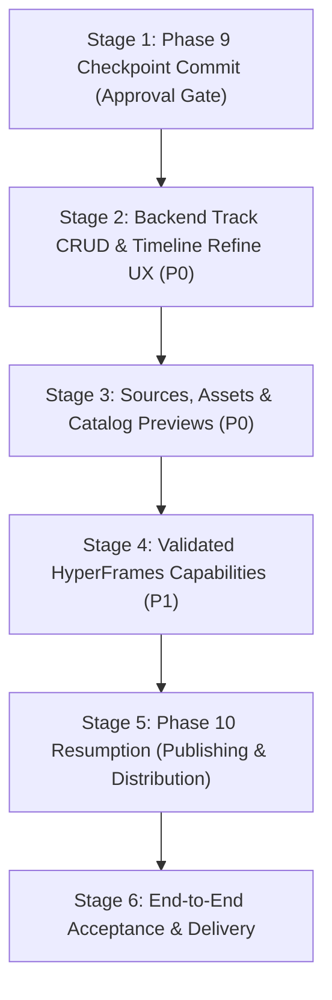

# ViralMint Roadmap Continuity & Refine UX Implementation Plan

**Date:** 2026-10-10 (Reconciled & Hardened)
**Baseline HEAD:** `c9619f507c71d52eff8ad7049fd053f4eb3dbb05` on `main`
**Governing Architecture:** 1 Main Agent, 1 Global Chat, Canonical `ProjectService` Persistence.
**Product Aspect Ratios:** Default 9:16 (Vertical), Optional 16:9 (Landscape). **Zero 1:1 Preset.**
**Core Product Routes:** `/trends` (Discover), `/motion` (Create, Review, Refine), `/channels` (Distribute).

---

## 1. Roadmap Alignment & Strategic Context

Phase 9 delivered the unified Code Workspace, live bi-directional CodeMirror 6 editing, file tree synchronization, and headless sandbox isolation. However, the subsequent usability audit of the `/motion` Refine workspace and Timeline identified concrete operational gaps:
- The Timeline UI lacks dynamic Track CRUD (adding/removing audio/caption/graphic tracks) and cross-track dragging, despite backend support for multi-track composition.
- Keyframe controls are cramped inside individual clip card containers (`width: widthPx`) instead of being organized into expandable property child lanes.
- On smaller laptop viewports (1366×768), 3-column panel competition consumes 63% of screen width and starves the preview stage to 227px height.
- Sources and Assets visual previews are dropped in the frontend UI (`thumbnail_url` and `thumb_url` ignored in favor of static icons).
- HyperFrames Catalog blocks lack non-destructive previews prior to timeline insertion.

This reconciled plan bridges Phase 9 completion and the next scheduled roadmap phases without fracturing the codebase or inventing unsupported features.

```
+-----------------------------------------------------------------------------------------+
|                                 VIRALMINT MASTER ROADMAP                                |
+-----------------------------------------------------------------------------------------+
| Phase 8B: Headless Render Engine & Node-Sidecar Sandbox (COMPLETE)                      |
| Phase 9:  Live Code Editor & Dual-Pane Refine Sync (GATED & HARDENED)                   |
|    |                                                                                    |
|    v                                                                                    |
| [INTER-PHASE REFINE & TIMELINE REMEDIATION] <--- (WE ARE HERE)                          |
|    * Stage 1: Safe Phase 9 Checkpoint Commit (Local Authorization Gate)                 |
|    * Stage 2: Backend Track CRUD & Expandable Keyframe Subtracks                        |
|    * Stage 3: Sources / Assets Posters & Ghost Hover Preview                            |
|    * Stage 4: Validated HyperFrames Capabilities Integration                            |
|    |                                                                                    |
|    v                                                                                    |
| Phase 10: Multi-Format Publishing (9:16 / 16:9), Export Queues & Social Distribution    |
| Phase 11: Real-Time Analytics & Trend Feedback Loop                                     |
+-----------------------------------------------------------------------------------------+
```

---

## 2. Reconciled Timeline Remediation Contract: Backend vs Frontend

A critical correction from the initial audit: **Timeline deficiencies are NOT purely frontend presentation issues**. While the render compiler (`HyperFramesAdapter`) can multiplex multiple tracks, the canonical timeline data layer requires explicit contract extensions.

### 2.1 Backend Contract Requirements (`ProjectService.py`, `models/project.py`)
1. **Canonical Track CRUD Operations:**
   - Implement `ADD_TRACK`, `DELETE_TRACK`, `REORDER_TRACKS`, `UPDATE_TRACK_PROPERTIES` inside `ProjectService.apply_atomic_operation()`.
   - All mutations MUST advance `revision_number`, update `current_revision_id`, generate an immutable `ProjectRevision`, and check CAS tokens.
2. **Track Compatibility & Semantic Typing:**
   - Enforce type invariants: audio clips cannot be moved to video/graphic tracks; graphics blocks cannot be placed on audio tracks.
   - Guard base tracks: "Main Video" (`track_video`) is a protected primary anchor; custom secondary video tracks require explicit picture-in-picture / overlay positioning.
3. **Stable Identity & Lock Enforcement:**
   - Assign immutable UUIDs to tracks (`track.id`).
   - Backend validation must reject clip mutations (split, trim, delete, move) on tracks flagged with `locked: true`.
4. **Stacking & Composition Order:**
   - Track order defines rendering z-index: higher graphic tracks render atop lower graphic/video tracks.
   - Audio tracks are summed via FFmpeg `amix` with individual track volume envelopes.

### 2.2 Frontend Wiring Requirements (`StudioTimelineWorkspace.jsx`)
1. **Header Label:** Change "Professional Timeline" header text to "Timeline".
2. **Track Headers:** Render explicit controls for Track Name, Mute toggle, Lock toggle, and Delete Track (for user-added tracks). Add an "Add Track" dropdown (`+ Audio Track`, `+ Caption Track`, `+ Graphic Track`).
3. **Expandable Property Subtracks:** Extract keyframe controls out of the clip card element. Render full-width collapsible child lanes under the parent clip for:
   - Position X
   - Position Y
   - Scale
   - Rotation
   - Opacity
4. **Vertical Cross-Track Dragging:** Allow clips to be dragged between compatible tracks of the same type without losing in/out timing.

---

## 3. Prioritized Remediation Matrix (P0 / P1 / P2)

### Priority P0: Critical Usability & Architecture Blockers

| ID | Issue & Reconciled Fix | Target Files | Complexity | Acceptance Gate |
| :--- | :--- | :--- | :--- | :--- |
| **P0-1** | **Phase 9 Source Checkpoint Staging**<br>Execute clean, non-destructive git commit of vetted Phase 9 files upon product owner sign-off. | `.git` repo manifest | Low (0.5 day) | Clean `git status`, zero whitespace warnings, all automated tests pass. |
| **P0-2** | **Timeline Label Correction**<br>Change user-facing label "Professional Timeline" to "Timeline". | `frontend/src/components/motion/StudioTimelineWorkspace.jsx` | Trivial (1 hr) | UI header displays "Timeline" cleanly. |
| **P0-3** | **Canonical Track CRUD & Vertical Drag**<br>Add `ADD_TRACK`, `DELETE_TRACK` operations to `ProjectService.py`; wire track headers and vertical clip movement in UI. | `backend/services/project_service.py`<br>`frontend/src/components/motion/StudioTimelineWorkspace.jsx` | Medium (3 days) | Users can create/delete tracks, drag clips vertically between compatible tracks; all changes persist via `ProjectRevision`. |
| **P0-4** | **Expandable Keyframe Property Lanes**<br>Render keyframes as collapsible child subtracks under parent clips spanning timeline width, keeping parent-child relation without detaching clips. | `frontend/src/components/motion/StudioTimelineWorkspace.jsx` | Medium (2-3 days) | Expanding keyframes displays Position, Scale, Rotation, Opacity lanes with clear hit targets and easing selection. |
| **P0-5** | **Laptop Viewport Responsive Rebalance**<br>Implement auto-collapsing sidebars on displays `< 1440px`. Guarantee minimum 380px preview stage height on 1366×768 laptops. | `frontend/src/pages/MotionGraphics.jsx`<br>`frontend/src/components/motion/StudioResourcePanel.jsx` | Medium (1-2 days) | Preview stage is at least 380px tall on 1366×768 screen; timeline shows 4+ visible tracks; zero horizontal clipping. |
| **P0-6** | **Sources & Assets Thumbnail Restoration**<br>Render stored `thumbnail_url` for Sources (with `referrerPolicy="no-referrer"`) and `thumb_url` for Assets instead of generic placeholder icons. | `frontend/src/components/motion/StudioResourcePanel.jsx` | Low (1 day) | YouTube/TikTok sources display video poster frames with duration chips; Assets show image/video thumbnails and audio badges. |
| **P0-7** | **Non-Destructive Ghost Hover Preview**<br>Add debounced (180ms) `GhostPreviewOverlay` in `StudioPreviewStage.jsx` that plays catalog animation without mutating project document or creating revisions. | `frontend/src/components/motion/StudioPreviewStage.jsx` | Medium (2 days) | Hovering catalog card plays animation in main player; mouse leave restores exact prior project state; project revision history untouched. |
| **P0-8** | **Catalog Query Optimization & In-Memory Cache**<br>Add in-memory caching to `RegistryAdapter.list_catalog_items()` for full catalog scans (`limit=500`), avoiding repeated disk I/O. | `backend/services/registry_adapter.py` | Low (1 day) | Full catalog scan loads in `< 50ms` on warm cache (down from 8.4s). |

---

### Priority P1: Enhanced Production Capabilities

| ID | Issue & Reconciled Fix | Target Files | Complexity | Acceptance Gate |
| :--- | :--- | :--- | :--- | :--- |
| **P1-1** | **Dynamic Audio Ducking & Carve**<br>Implement automated voiceover-ducking curve in FFmpeg export and Web Audio preview using `data-fx-carve` pattern from HyperFrames. | `backend/services/hyperframes_adapter.py`<br>`backend/services/motion_render_service.py` | Medium (2 days) | Music bed volume dips automatically by -12dB whenever voiceover audio clip is active. |
| **P1-2** | **Validated Caption Style Integration**<br>Incorporate vetted style presets from `embedded-captions` into the Caption Inspector. | `frontend/src/pages/MotionGraphics.jsx`<br>`frontend/src/components/motion/StudioTimelineWorkspace.jsx` | Medium (2 days) | Users can select caption styles (e.g., `terminal`, `neonsign`, `stomp`) with instant visual preview. |
| **P1-3** | **Context-Aware AI Prompt Population**<br>Add "Ask AI to Insert" button on Catalog cards that synthesizes playhead time and composition context into the single global Chat. | `frontend/src/components/motion/StudioResourcePanel.jsx`<br>`frontend/src/components/chat/ChatInterface.jsx` | Low (1 day) | Clicking button populates prompt in global chat; main agent executes atomic timeline operation. |

---

### Priority P2: Workflow & Polish

| ID | Issue & Reconciled Fix | Target Files | Complexity | Acceptance Gate |
| :--- | :--- | :--- | :--- | :--- |
| **P2-1** | **Live Audio Decibel Meter**<br>Port `AudioMeterStrip.tsx` from HyperFrames studio into the Timeline toolbar. | `frontend/src/components/motion/StudioTimelineWorkspace.jsx` | Low (1 day) | Live stereo peak/RMS VU meters bounce during playback and scrubbing. |
| **P2-2** | **Dual-Pane Splitter Memory**<br>Persist user-dragged panel widths in `localStorage`. | `frontend/src/pages/MotionGraphics.jsx` | Trivial (0.5 day) | Panel dimensions persist across page refreshes. |

---

## 4. The 6-Stage Roadmap Execution Sequence



### Stage 1: Phase 9 Checkpoint Commit (Approval Gate)
- **Objective:** Secure working Phase 9 code with zero regression.
- **Actions:**
  1. Await explicit Product Owner sign-off on `PHASE_9_CHECKPOINT_FINAL_SECURITY_CLEARANCE.md`.
  2. Stage the 22 vetted files (backend routers, models, CodeMirror 6 components, unit/regression tests, documentation reports).
  3. Execute clean commit on `main`.
- **Exit Gate:** Clean git working tree; all automated tests pass.

### Stage 2: Backend Track CRUD & Timeline Refine UX Remediation
- **Objective:** Fix spatial density and establish robust multi-track data contracts.
- **Actions:**
  1. Rename header to "Timeline".
  2. Implement `ADD_TRACK`, `DELETE_TRACK`, `REORDER_TRACKS` in `ProjectService.py` with CAS validation.
  3. Implement responsive panel auto-collapse for laptop displays (`< 1440px`), securing a 380px minimum preview stage.
  4. Add Track Header controls (Add Track, Delete Track, Mute, Lock) and vertical clip dragging.
  5. Implement expandable keyframe property subtracks (Position, Scale, Rotation, Opacity) spanning timeline width.
- **Exit Gate:** Live browser verification on 1920×1080 and 1366×768 displays.

### Stage 3: Sources, Assets, and Catalog Visual Previews
- **Objective:** Give creators immediate visual feedback across all media.
- **Actions:**
  1. Update `StudioResourcePanel.jsx` to render stored `thumbnail_url` (Sources) and `thumb_url` (Assets).
  2. Implement in-memory manifest caching in `RegistryAdapter.py` for full scans (`limit=500`).
  3. Implement `GhostPreviewOverlay` in `StudioPreviewStage.jsx` for 180ms debounced hover previews of catalog blocks.
- **Exit Gate:** Hovering a catalog card previews animation in the player without modifying the project document; thumbnails display properly in Sources and Assets tabs.

### Stage 4: Validated HyperFrames Capabilities Integration
- **Objective:** Level up video production quality using verified Apache 2.0 assets.
- **Actions:**
  1. Implement automated audio ducking (`data-fx-carve`) in `HyperFramesAdapter` and FFmpeg render pipeline.
  2. Integrate vetted caption style identities from `embedded-captions`.
  3. Add context-aware prompt generation feeding the single global Chat.
- **Exit Gate:** Rendered multi-track videos showcase ducked music under voiceovers and styled captions.

### Stage 5: Resumption of Roadmap Sequence (Phase 10)
- **Objective:** Resume scheduled master roadmap progress.
- **Actions:**
  1. Phase 10: Multi-format rendering (9:16 vertical default, 16:9 landscape option. Zero 1:1 preset).
  2. Background render queues with progress websockets.
  3. Direct export to TikTok and YouTube via connected social accounts (`/channels`).
- **Exit Gate:** Phase 10 acceptance test suite pass.

### Stage 6: End-to-End Acceptance & Delivery
- **Objective:** Comprehensive end-to-end platform validation.
- **Actions:**
  1. Execute automated full-lifecycle tests (`test_phase9_and_refine_remediation.py`).
  2. Verify performance metrics (timeline 60fps scrub, catalog load `< 150ms`, hover preview launch `< 250ms`).
  3. Deliver final sign-off documentation to the Product Owner.

---

## 5. Architectural Guardrails (Non-Negotiable)

1. **Strict Single Agent / Single Chat Contract:** All AI interactions flow through the existing 1 Main Agent and 1 Global Chat. No secondary floating chat panels or decoupled agent personalities.
2. **Authoritative State Preservation:** Transient UI interactions (such as hover previews) MUST NOT create `ProjectRevision` entries or touch database records.
3. **Canonical Document Authority:** All timeline mutations MUST flow through `ProjectService.apply_atomic_operation()` to ensure CAS concurrency tokens, undo/redo stacks, and headless render parity remain intact.
4. **Supported Aspect Ratios:** Exclusively 9:16 (vertical, default) and 16:9 (horizontal, optional). No 1:1 preset.
5. **Third-Party Asset Due Diligence:** The top-level Apache 2.0 license applies to the core HyperFrames engine; individual community blocks, fonts, and media assets must be evaluated individually for redistribution rights prior to commercial bundling.
6. **Git Discipline:** Zero git write operations (`git add`, `git commit`, `git push`) will be executed without explicit product owner instruction.
