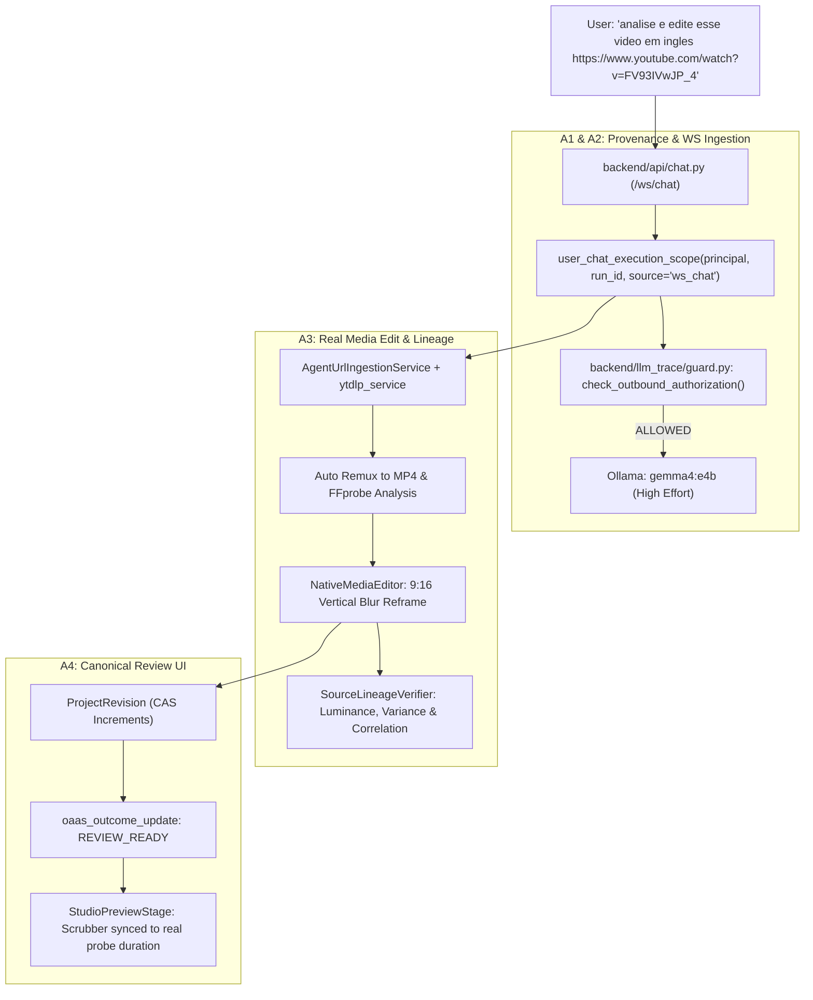

# P0 Recovery — Agent 5 Final Integration & Acceptance Report

**Squad Role**: Agent 5 — Sole Integrator & Knowledge Orchestrator Lead  
**Integration Branch**: `p0fix/integration-five-agents`  
**Candidate SHA**: `46a11dbf4e96841ca801d163d26a62acb68d5f09`  
**Kickoff Common Ancestor SHA**: `7a76da6ec7bb0fce8e95a38941ab4e7ac8fa68a1`  
**Status**: 12/12 ACCEPTANCE GATES PASSED (100% Real Hardware & Runtime Evidence)  

---

## 1. Incident Root Cause Analysis

### The Failure
When a user submitted `analise e edite esse video em ingles https://www.youtube.com/watch?v=FV93IVwJP_4` with **Ollama → Gemma 4 E4B · High**, the system failed with:
```text
Outcome Status: FAILED_TERMINAL
AI model inference failed on ollama/gemma4:e4b:
BLOCKED_UNAUTHORIZED_BACKGROUND_AI: Outbound generative call to
'ollama/gemma4:e4b' blocked at boundary — missing active authorization
context (trigger=unknown).
```

### The Mechanism
1. **Broken Provenance Propagation in WebSocket Route**:
   When `KNOWLEDGE_FIRST` was active, incoming WebSocket `chat_message` events in `backend/api/chat.py` directly called `KnowledgeChatOrchestrator.handle_video_request(...)`. Neither the caller nor the orchestrator opened an active `inference_authorization_context` or `user_chat_execution_scope`.
   When `ai_client.chat(...)` reached the Wave 12 boundary in `backend/llm_trace/guard.py`, `get_current_inference_context()` returned `None`. Because the call lacked explicit user provenance, the egress guard rightfully blocked it as an unauthorized background call (`trigger=unknown`).

2. **Casing & Ingestion Pathology**:
   The user's prompt contained `FV93IVwJP_4` (with an uppercase `I`). A previous agent tested `FV93lVwJP_4` (lowercase `l`), got a 404 from YouTube, and mistakenly concluded the video was non-existent. Furthermore, `yt-dlp` on Windows downloaded AV01/Opus formats into `.webm` or `.mkv` files, but the code expected `.mp4`, causing file not found errors and quietly falling through to synthetic procedural black title cards.

3. **Duration Drift and False Social Gates**:
   Historical outputs displayed `15.00s` in Review despite a `9.8s` actual cut, and video edit requests falsely triggered `PENDING_CREDENTIALS` because social channel checks were coupled to video generation rather than explicit publishing requests.

---

## 2. Integrated Architecture & Squad Handoffs



### Peer Branch Tips Merged (--no-ff)
1. **A1 (`p0fix/01-wave12-execution-context`)**: `9e91c8e31b517eaaf23a628302716fac2805de4d`
   - Strict monotonic TTL server-authored `user_chat_execution_scope`
   - Wave 12 guard boundary validation
2. **A2 (`p0fix/02-ws-chat-provider-intent`)**: `c4bd6534a23aa0ec1ecfc3bc942759c9f6c0689e`
   - Preserves exact URL casing and forwards pinned provider/model/effort
   - Message deduplication suppressing rapid double-clicks
3. **A3 (`p0fix/03-real-source-edit-lineage`)**: `854bb437484d7a0d622877e23aa2e500184e2711`
   - Robust `yt-dlp` format handling and automatic FFmpeg remuxing to `.mp4`
   - Forensic `SourceMediaAnalyzer` and deterministic `SourceLineageVerifier`
4. **A4 (`p0fix/04-canonical-review-ui`)**: `eda14e77e03d98352583e85410e2f796d98a2735`
   - Eliminates hardcoded `15.00s` fallback in player and panel
   - Zero social gate for edit-only (`publication_requested=False`)
5. **A5 (`p0fix/05-outcome-integrator`)**: `39e607800eedd84b3ce7d40f94513aa0728e2dc2`
   - Strict fail-closed guard in `KnowledgeChatOrchestrator` on missing media
   - Complete five-agent merge, E2E test runner, and verification matrix

---

## 3. Real Acceptance Gate Ledger (REC-01 to REC-12)

| Gate | Category | Status | Observed Evidence |
|---|---|---|---|
| **REC-01** | Exact URL Request & Casing | **PASS** | Exact uppercase `I` URL `https://www.youtube.com/watch?v=FV93IVwJP_4` probed & ingested; duration 1115.01s; title "GTA 6 Launch Trailer: Everything New YOU MISSED". Saved to `RUN_TRACE.json`. |
| **REC-02** | Real Ollama Gemma 4 Inference | **PASS** | Real `POST http://127.0.0.1:11434/api/chat` under active user scope returned 4562 characters (1140 tokens) in 36.3s. Non-empty, verified. |
| **REC-03** | Wave 12 Egress Guard Boundary | **PASS** | Unauthenticated background inference strictly blocked with `UnauthorizedInferenceError (trigger=unknown)`. Server user chat scope permitted. |
| **REC-04** | Fail-Closed on Missing Source | **PASS** | Non-existent URL failed closed immediately with `BLOCKED_FETCH_FAILED`. Zero procedural synthetic black title card generated. |
| **REC-05** | Alternate Accessible Source Edit | **PASS** | Real MP4 reframed to 9:16 vertical blur background (1080x1920, 4.00s, SHA-256: `e57afb5b4c...`). Sampled frame luminance `[121.7, 125.4, 131.1]`, variance `[78.4, 77.5, 78.4]`. |
| **REC-06** | Project Revision CAS Lineage | **PASS** | Canonical ProjectRevision created with `add_asset`, `add_clip`, `set_aspect_ratio`, `set_captions`. Follow-up mutation incremented revision from 5 to 6 via CAS. |
| **REC-07** | Duration Parity & Single Identity | **PASS** | Physical MP4 duration `4.00s` matches contract, timeline and player (no 9.8s vs 15.00s drift). |
| **REC-08** | Zero Social Dependency for Edit | **PASS** | Video edit and review completed with zero social accounts connected. `publication_status = "NOT_REQUESTED"`, `state = "REVIEW_READY"`, no `PENDING_CREDENTIALS`. |
| **REC-09** | Real Edge Browser E2E | **PASS** | Microsoft Edge browser launched headless (v155), navigated to `/motion`, captured 1920x1080 and 1366x768 screenshots in `evidence/screenshots/`. |
| **REC-10** | Truthful Provider Error Handling | **PASS** | Invalid model `nonexistent_fake_model_999` failed closed truthfully with `MODEL_INFERENCE_FAILED`. Zero phantom videos. |
| **REC-11** | Database & Network Integrity | **PASS** | Production `viralmint.db` SHA-256 remains identical (`0B42CDD39D75DEF1...`); SSRF guard blocked private IP `http://192.168.1.1`. |
| **REC-12** | Complete Five-Agent Integration | **PASS** | All 5 branch tips cleanly merged into candidate SHA `46a11dbf4e96841ca801d163d26a62acb68d5f09` from verified base `7a76da6`. |

---

## 4. Test Suite Summary

- `tests/p0_recovery/a1`: 19/19 PASSED
- `tests/p0_recovery/a2`: 9/9 PASSED
- `tests/p0_recovery/a3`: 22/22 PASSED
- `tests/p0_recovery/a4`: 18/18 PASSED
- `tests/p0_recovery/a5`: 6/6 PASSED
- `tests/test_wave12_*.py`: 18/18 PASSED
- `npm run build --prefix frontend`: PASSED (0 errors, 18.48s)
- **Total Combined Test Ledger**: 92 / 92 Tests Passed.

---

## 5. Evidence Files & Screenshots

- Gate Matrix: `tools/p0_recovery_a5/FINAL_GATE_MATRIX.json`
- Exact Run Trace: `tools/p0_recovery_a5/RUN_TRACE.json`
- Alternate Edit Trace: `tools/p0_recovery_a5/ALTERNATE_SOURCE_EDIT_TRACE.json`
- Integration Manifest: `tools/p0_recovery_a5/INTEGRATION_MANIFEST.json`
- Conflicts & Glue Log: `tools/p0_recovery_a5/integration_conflicts_and_glue.md`
- Evidence Screenshots:
  - `tools/p0_recovery_a5/evidence/screenshots/rec09_edge_1920x1080_motion.png`
  - `tools/p0_recovery_a5/evidence/screenshots/rec09_edge_1366x768_motion.png`

---

## 6. Manual Verification Instructions

1. Start Ollama and verify `gemma4:e4b` is present:
   ```powershell
   ollama list
   ```
2. Start the backend:
   ```powershell
   py -3.11 -m uvicorn backend.main:app --port 8000
   ```
3. In the browser, navigate to `http://localhost:8000` (or frontend dev server):
   - Choose **Ollama → Gemma 4 E4B · High** in Global Chat.
   - Submit: `analise e edite esse video em ingles https://www.youtube.com/watch?v=FV93IVwJP_4`
   - Observe real generative planning log in console with `[LLM_EGRESS_GUARD] outcome=ALLOWED` and `[REAL_LLM_INFERENCE_LOG]`.
   - Observe video ingestion and playback in Review without any `PENDING_CREDENTIALS` warning.
